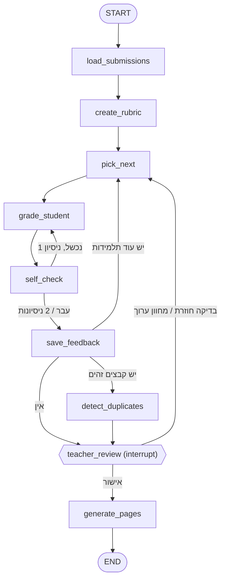
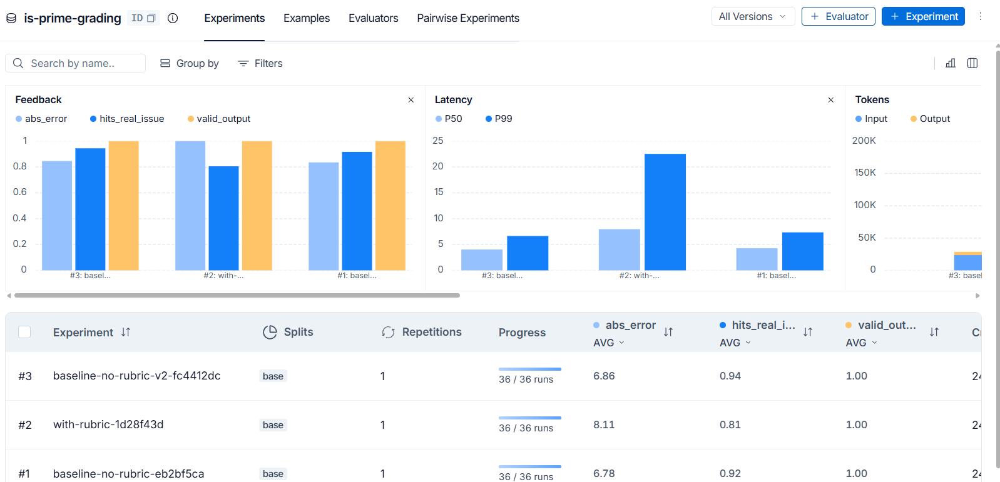
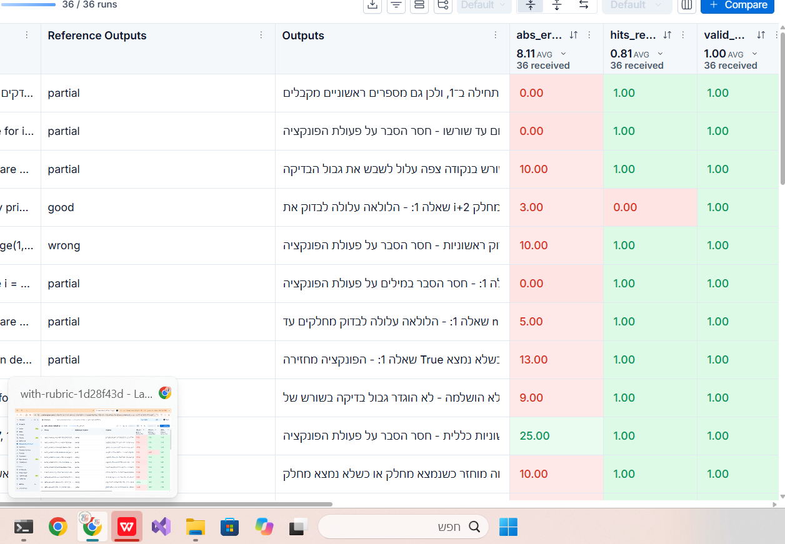
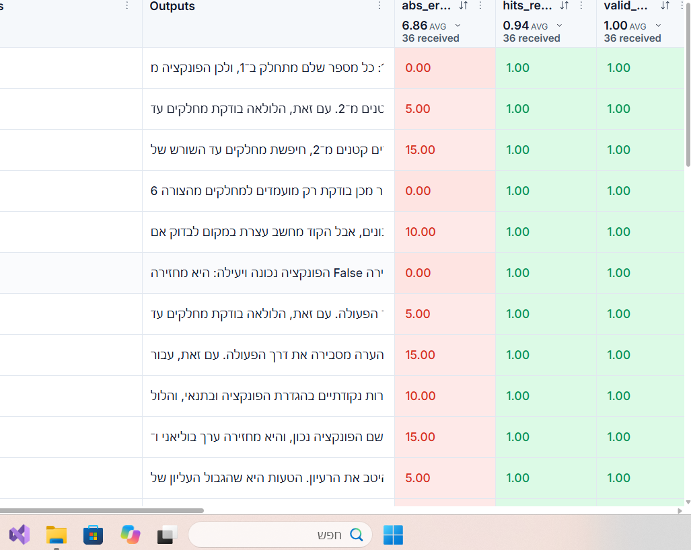

# סוכן לבדיקת תרגילים עם אישור מורה

סוכן שבודק הגשות של תלמידות: יוצר מחוון מתיאור התרגיל, בודק כל הגשה (גם דף עם כמה שאלות), מציג למורה דף סיכום של כל הכיתה, ורק אחרי אישור המורה יוצר קובץ משוב לכל תלמידה.
בנוי עם **LangGraph**, עם עקבות והערכה ב-**LangSmith**.

## חלוקת אחריות
- **המודל** – כל החלטת תוכן: מחוון, ניקוד לכל שאלה, הערה, דגלים (לא הוגש / לא רלוונטי / לא ניתן לבדיקה), בדיקה עצמית.
- **הקוד** – קריאת קבצים, החלפת שמות ב-ID, ניתוב בגרף, חישוב הציון הסופי (סכום השאלות + בונוס), זיהוי קבצים זהים, יצירת קבצי המשוב.

## הגרף



עמידה בדרישות התרגיל:

| דרישה | איפה |
|---|---|
| LangGraph | `graph.py` |
| לולאה / ענף מותנה | לולאת בדיקה עצמית (עד 2 ניסיונות), לולאה על כל התלמידות, ענף `detect_duplicates` |
| interrupt + human-in-the-loop | `teacher_review` עם `MemorySaver` ו-`Command(resume=...)` |
| דאטהסט והערכה ב-LangSmith | `evals/` |
| README עם traces ותובנה | כאן |

## כללים עיקריים
- **פרטיות:** למודל נשלחים רק `student_id` (S01...) ותוכן התשובה. שם התלמידה, וגם שמות של תלמידות אחרות שמופיעים בקובץ, מוחלפים לפני השליחה.
- **ניקוד:** השאלות מסתכמות ב-100, והמודל מחלק אותן לפי אורך, קושי וסוג (קוד / מילולי). אם הקריטריונים בשאלה מחלקים פחות מהניקוד שלה (לפחות 90%), ההפרש ניתן כבונוס. הניקוד על המהות ולא על ניסוח; באג קטן בגישה נכונה מקבל ניקוד חלקי גבוה.
- **הערות:** לכל שאלה – עד 2 שורות קצרות של בעיות, או "תשובה מצוינת / מעולה / טובה".
- **קבצים זהים:** אותן מילים באותו סדר (רווחים לא משנים), גם אם רק שם התלמידה שונה. כל תלמידה בקבוצה מסומנת ומאבדת 70% מהציון; לא נקבע מי העתיקה ממי, והמורה יכולה לערוך לפני האישור.

## הרצה

```
python -m venv .venv
.venv\Scripts\python.exe -m pip install -r requirements.txt
```
להעתיק את `.env.example` ל-`.env` ולמלא `OPENAI_API_KEY` ו-`LANGSMITH_API_KEY`.

### ממשק המורה (מומלץ)
לחיצה כפולה על **`הפעלת המערכת.bat`**. נפתח חלון שחור (להשאיר אותו פתוח; סגירתו עוצרת את המערכת), ואחרי כמה שניות הדפדפן נפתח בכתובת `http://localhost:8501`.
אפשר גם להפעיל ידנית: `.venv\Scripts\python.exe -m streamlit run app.py`

ארבעה מסכים:
1. **העלאה** – תיאור התרגיל (כתיבה או קובץ txt/docx) וקבצי התלמידות (כמה קבצים או zip). הכפתור "נסי עם כיתה לדוגמה" טוען דף תרגילים עם 5 עבודות.
2. **בדיקה** – התקדמות בזמן אמת: איזו תלמידה נבדקת ומה המערכת עושה.
3. **סיכום ואישור** – נתוני הכיתה והתפלגות ציונים; עריכת ציון והערה בטבלה או לכל שאלה בנפרד, לצד העבודה המקורית; עריכת המחוון; סימון לבדיקה חוזרת; אישור.
4. **דפי משוב** – הורדת כל הדפים ב-zip, כל דף בנפרד, או טבלת ציונים (CSV).

דפי המשוב נשמרים גם בתיקייה `output/run_<תאריך>_<שעה>/`.

### הרצה מהטרמינל (בלי ממשק)
```
.venv\Scripts\python.exe run_cli.py --input sample_data --exercise exercise.txt
.venv\Scripts\python.exe run_cli.py --input sample_data_multi --exercise exercise_multi.txt
```
שם הקובץ (בלי סיומת) = שם התלמידה. נתמכים קבצי קוד, `.txt` ו-`.docx`. קבצי המשוב נשמרים ב-`output/`.

> ברשת עם סינון / אנטי-וירוס שבודק HTTPS: ההתקנה דורשת `pip install --use-feature=truststore ...`, ובזמן ריצה החבילה `truststore` כבר מופעלת ב-`llm.py`.

## הערכה ב-LangSmith

- **דאטהסט** `is-prime-grading`: 36 תשובות לתרגיל `is_prime` (טובות / חלקיות / שגויות, כולל פתרונות נכונים בכתיבה שונה). הציונים נקבעו על ידי מודל שהונחה לבדוק כמו מורה מנוסה, ונבדקו ותוקנו ידנית (למשל a26, a34).
- **Evaluators:** `abs_error` – הפרש מהציון האנושי; `valid_output` – תקינות הפלט; `hits_real_issue` – LLM-as-judge: האם ההערה מתייחסת לטעות האמיתית.
- **מודלים:** סוכן `gpt-6.2-sol`, שופט `gpt-6-luna`. שני המודלים תומכים רק ב-`temperature=1`.

```
.venv\Scripts\python.exe evals\upload_dataset.py
.venv\Scripts\python.exe evals\run_experiments.py
```

### תוצאות

| מדד | 1. בסיסי, בלי מחוון | 2. מחוון + בדיקה עצמית | 3. בסיסי + כלל "ערכי החזרה" |
|---|---|---|---|
| הפרש ממוצע מהציון האנושי (נמוך = טוב) | 6.78 | 8.11 | 6.86 |
| ↳ good / partial / wrong | 1.2 / 8.9 / 10.5 | 2.2 / 10.2 / 12.3 | 1.0 / 8.6 / 11.5 |
| פלט תקין | 100% | 100% | 100% |
| ההערה מתייחסת לטעות האמיתית | 92% | 81% | 94% |

**מסקנה:** המחוון המפורש לא שיפר את ההתאמה לציון המורה, ואף הרע אותה. הפער בין ניסויים 1 ו-3 קטן מהשונות בין הרצות (`temperature=1`), ולכן אין לו משמעות סטטיסטית. הכלל בניסוי 3 נכתב לסוג טעות שקיים בדאטהסט, ולכן יש סיכון להתאמת-יתר למבחן.

### צילומי מסך מ-LangSmith

שלושת הניסויים על הדאטהסט – ממוצע לכל evaluator, זמן תגובה (Latency) וטוקנים:



ניסוי 2 (מחוון + בדיקה עצמית) – הערה, `abs_error`, `hits_real_issue` ו-`valid_output` לכל תשובה:



ניסוי 3 (בסיסי + כלל "ערכי החזרה") – אותן עמודות:



### תובנה מה-traces

**הסוכן עם המחוון "מחפש בעיות" גם בתשובות נכונות.**
כל המקרים שבהם השופט קבע שההערה לא מתאימה (`hits_real_issue = 0`) הם תשובות **נכונות** (`real_issue = none`):

| ניסוי | תשובות נכונות שקיבלו הערה על בעיה שלא קיימת |
|---|---|
| 1. בסיסי | 3 מתוך 12 (a02, a07, a12) |
| 2. מחוון | **7 מתוך 12** (a01, a02, a04, a05, a07, a08, a12) |
| 3. בסיסי + כלל | 2 מתוך 12 (a07, a12) |

בניסוי 2 רוב ההערות האלה הן "ההסבר לא מציין מה מוחזר כשנמצא מחלק", למשל ב-a01, שבו ההסבר כן כתוב (נימוק השופט: *"the grader's claimed omission is not present"*).
הסיבה, לפי ה-traces: במחוון שנוצר יש קריטריון "הסבר מתאר נכון כיצד הפונקציה קובעת את ערך ההחזרה", והפרומפט מבקש "לרשום רק את הבעיות". השילוב גורם למודל לחפש חוסר בהסבר גם כשאין. בניסויים בלי מחוון ההערות השגויות הן מסוג אחר: הערות על מקרי קצה שלא נדרשו (מספרים גדולים מאוד, עומק רקורסיה).

ממצאים נוספים מהתוצאות לכל תשובה:
- הכלל "מבנה נכון עם טעות בערכי ההחזרה" תיקן בדיוק את a26: מ-50 ל-85, כמו ציון המורה. אבל באותו ניסוי הסוכן נעשה מקל יותר בתשובות חלקיות אחרות (a13: 75 → 85, a21: 70 → 85), ולכן הממוצע לא השתפר.
- בכל הניסויים הסוכן מקל מדי בתשובות שגויות. לדוגמה, a33 ("כל מספר גדול מ-1 ראשוני") קיבלה מהמורה 5, ומהסוכן 25–30.
- הבדיקה העצמית נכשלה פעמיים רק ב-3 תשובות (a19, a25, a26), כלומר ברוב התשובות היא לא שינתה את הבדיקה.

**שיפור אפשרי לניסוי הבא (לא נבדק):** להוסיף לפרומפט "אם התשובה עומדת בדרישות, אל תחפש בעיות בפרטים שלא נדרשו".

## מבנה התיקיות

```
הפעלת המערכת.bat    לחיצה כפולה פותחת את ממשק המורה
app.py              נקודת הכניסה של הממשק (Streamlit)
ui/                 קוד הממשק: עיצוב, רכיבים, ומסך לכל שלב (views/)
graph.py            בניית הגרף
nodes/              loader, rubric, grading, duplicates, review, output
schemas.py          מבני הנתונים (Pydantic)
prompts.py          הפרומפטים
llm.py              יצירת המודל (סוכן / שופט)
run_cli.py          הרצה מהטרמינל עם אישור מורה
evals/              דאטהסט, evaluators, סקריפט ניסויים, תוצאות
images/             צילומי מסך מ-LangSmith
sample_data*/       הגשות לדוגמה
output/             קבצי המשוב
```
